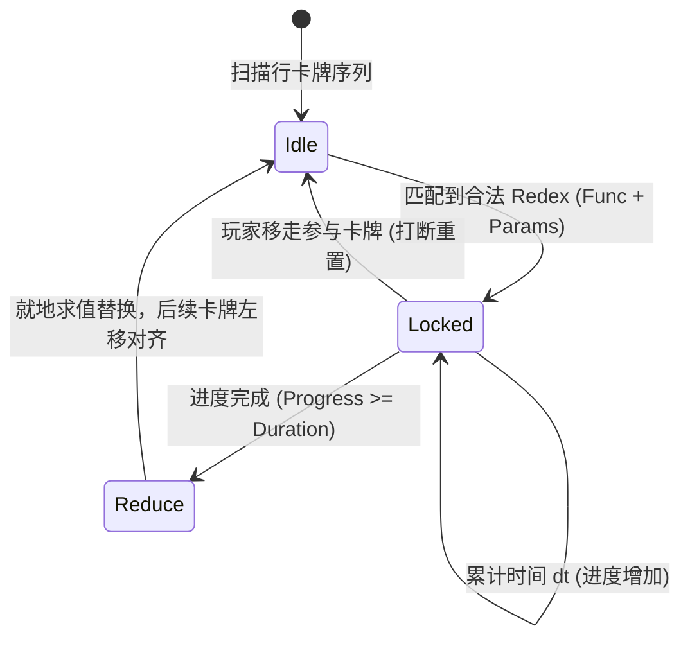

# Textlands 游戏设计规范与规则手册 (Game Specification)

> **文档标识**：`DOC-GAME-SPEC-001`  
> **当前版本**：`v1.0.0` (Formal Baseline)  
> **核心定位**：**实体化 Lisp 机器卡牌流（Lisp Machine Card Flow Game）**  
> **文档维护原则**：后续任何机制变动、配方扩展、命令扩展均在此文档基础上以 Semantic Versioning (语义化版本) 进行更新，并在文末记录变更日志 (Changelog)。

---

## 1. 实体与数据模型 (Entities & Schema)

### 1.1 卡牌模型 (Card Schema)
桌面上的所有实体统一为一张卡牌，表示为纯数据不可变哈希表：

```scheme
(hash
  "id"           101             ;; 全局唯一卡牌实例 ID (整数)
  "name"         "砍伐"          ;; 显示名称 (字符串)
  "icon"         "🪓"            ;; 单个 Emoji 或 2 字符图标
  "kind"         "func"          ;; 分类: "item"(普通物品) | "func"(函数卡)
  "type"         "tool"          ;; 类型标签: "unit", "food", "res", "tool", "building" 等
  "meta"         (hash ...))     ;; 扩展元数据 (见下文)
```

#### 函数卡专用属性 (`kind == "func"` 时在 `meta` 中定义)
- `"inputs"`: 期望的参数类型列表，例如 `'("tree")` 或 `'("wood" "wood")`。
- `"output"`: 产物原型字典（包含产物 `name`, `icon`, `kind`, `type` 等）。
- `"duration"`: 反应所需时间（单位：秒）。
- `"consume_self"`: 布尔值。
  - `#t`（一次性算子 / 咒语）：规约完成后自身被消耗销毁。
  - `#f`（常驻算子 / 机器）：规约完成后自身保留在原位，仅消耗参数。

### 1.2 桌面网格模型 (Board Model)
桌面是一个二维受限网格容器，保存在全局状态树中：

```scheme
(hash
  "width"    8                  ;; 每行最大容量 (Max Cards Per Row)
  "height"   4                  ;; 当前行数 (Row Count: 行索引 0 到 height - 1)
  "lines"    (list ...)         ;; 存储各行卡牌列表，每行是 (list Card ...)
  "recipes"  (list ...))        ;; 全局内置函数配方注册表
```

- **排列方式**：单行内严格左对齐（从左到右依次排列）。
- **行头（Head）**：索引为 `0` 的卡牌（最左侧）。
- **行尾（Tail）**：索引为 `len - 1` 的卡牌（最右侧）。
- **扩容机制**：`width` 和 `height` 可以通过特定的建筑/算子卡牌消耗道具进行永久提升。

---

## 2. 交互命令集规范 (Orthogonal Command Grammar)

控制台采用精炼指令驱动，**支持不带括号直接输入**（如 `m 0 1`，底层由 Reader 自动包装或分词解析）。

### 2.1 行间转移指令（正交命名法）
基础指令为 `m`（Move），通过后缀表示 **[源端]** 与 **[目的端]**。  
- 默认端点为 **`t` (Tail, 行尾)**。
- 行首特殊指定为 **`h` (Head, 行头)**。

| 指令格式 | 完整名称 | 语义定义 | 失败/前置拦截条件 |
| :--- | :--- | :--- | :--- |
| `m <src> <dst>` | Move Tail $\rightarrow$ Tail | 取出 `src` 行**尾部**卡牌，推入 `dst` 行**尾部** | `src` 为空行，或 `dst` 已达容量上限 `width` |
| `mh <src> <dst>` | Move Tail $\rightarrow$ Head | 取出 `src` 行**尾部**卡牌，插入到 `dst` 行**头部**（最左端） | 同上 |
| `mhh <src> <dst>`| Move Head $\rightarrow$ Head | 取出 `src` 行**头部**卡牌，插入到 `dst` 行**头部**（最左端） | 同上 |
| `mht <src> <dst>`| Move Head $\rightarrow$ Tail | 取出 `src` 行**头部**卡牌，推入 `dst` 行**尾部** | 同上 |
| `ma <src> <dst>` | Move All | 将 `src` 行中的所有卡牌整体依次搬移到 `dst` 行尾部 | `dst` 剩余容量不足以容纳 `src` 所有卡牌 |

### 2.2 辅助生活指令
| 指令格式 | 语义定义 | 说明 |
| :--- | :--- | :--- |
| `c <row>` | 清理 / 出售 | 出售 `row` 行尾部的 1 张卡牌，根据价值直接换取金币 |
| `eat <row>` | 进食 | 优先消耗 `row` 行内的第一份食物卡，维持村民生存 |

### 2.3 容错与无副作用保障
- **越界检查**：行索引 `< 0` 或 `$\ge height$` 时返回明确报错日志，不修改任何状态。
- **溢出保护**：当目标行长度等于 `width` 时，拒绝移入并告警。
- **原子性**：转移操作为原子变更，不会出现卡牌凭空消失或复制。

---

## 3. 求值与规约机理 (Evaluation & Reduction Engine)

### 3.1 核心范式：Applicative Order 求值（自内向外）
- 一行卡牌从左到右是一个连续序列。
- 只要出现 **`[Function 卡]` + `[连续合法纯数据参数序列]`**，便构成一个最小可求值表达式（Redex）。
- **嵌套原则**：如果 Function 后面紧跟的是另一个 Function 卡，外层 Function 不满足“纯数据参数”条件，必须等待内层 Function 先规约出结果。

```text
示例：[ 🔨 制作 ] [ 🪓 砍伐 ] [ 🌲 树木 ]
  1. [ 🔨 制作 ] 期望参数为 2个 [ 🪵 原木 ]，后跟的是 [ 🪓 砍伐 ]，类型不匹配，外层等待。
  2. [ 🪓 砍伐 ] 期望参数为 1个 [ 🌲 树木 ]，后跟树木，满足 Redex！
  3. [ 🪓 砍伐 ] + [ 🌲 树木 ] 进入锁定倒计时。
  4. 倒计时完成，原地规约为 [ 🪵 原木 ]。
  5. 序列变为：[ 🔨 制作 ] [ 🪵 原木 ] ...
```

### 3.2 运行生命周期：四阶段状态机



1. **扫描与匹配 (Pattern Matching)**：
   - 遍历每行，按序寻找 `kind == "func"` 且未处于锁定状态的卡牌。
   - 检查其右侧紧邻的若干张卡牌类型是否严格等于其 `inputs`。
   - 匹配成功：为该组卡牌分配一个求值会话（Evaluation Session），记录锁定状态与起始时间。
2. **锁定与计时 (Locking & Timing)**：
   - 处于反应中的卡牌外观显示进度条（例如 `[ 🪓 砍伐 50% ]` 或在行末显示进度）。
   - **允许玩家随时打断**：若玩家通过命令将处于锁定的任一卡牌移出行外，该反应立刻取消，进度归零，卡牌完好无损。
3. **就地规约 (In-place Reduction)**：
   - 倒计时结束触发结算：
     - 若 `consume_self == #t`（一次性）：消耗 `Func + Params` 共 $1 + N$ 张卡，在原 Func 所在位置生成产物卡牌，右侧其余卡牌自动向左对齐滑移。
     - 若 `consume_self == #f`（常驻机器）：保留原 Func 卡牌，消耗其右侧的 $N$ 张参数卡，并将产物放在 Func 之后，其余卡牌紧跟其后。
4. **背压机制 (Backpressure / Line Full)**：
   - 若规约导致该行卡牌超出 `width`，或者目标位置没有足够空间存放产物，反应暂停产出，直到玩家腾出空位。

---

## 4. 渲染规范 (ANSI Rendering Contract)

在 80x24 终端上，每行由行状态标头与卡牌流组成：

```text
=== Textlands: Lisp Board (4x8) ===
[00] [ 🪓 砍伐 60% ] [ 🌲 树木* ]                 | 进度: 3.0s / 5.0s
[01] [ 🧑 村民 ] [ 🫐 浆果 ] [ 🪨 石头 ]
[02] [ 🪙 金币 ] [ 🪙 金币 ]
[03] (空)
--------------------------------------------------------------------------------
[状态] 资源: 🪙 x2 | 食物度: 85% | 提示: 输入 m 0 1 进行移牌
> : 
```

- `*` 表示当前被锁定的参数卡。
- 正在进行计算的卡牌显示高亮前景色或百分比进度。

---

## 5. 变更历史记录 (Changelog)

| 版本号 | 日期 | 变更内容 | 提出人/状态 |
| :--- | :--- | :--- | :--- |
| `v1.0.0` | 2026-11-03 | 初始基线确立：正交命令集、卡牌Schema、Applicative Lisp 求值机理、网格模型 | Formal Approved |
